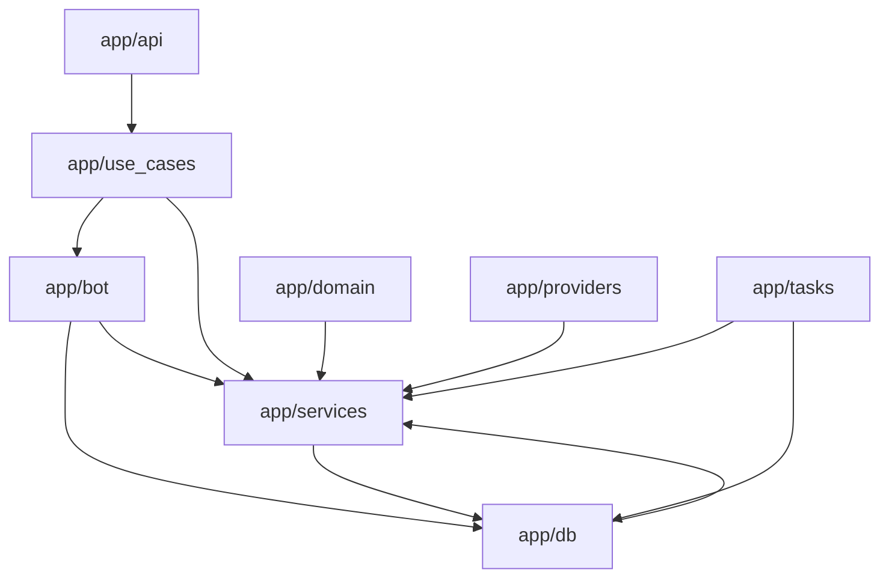

# Audit Radar Bot — 2026-09-21

Phase A uniquement. Lecture du dépôt au commit `234cbf4` (`main`, poussé avant rédaction). `.env` non lu. Scripts non exécutés. Suite de tests non lancée. Aucun fichier applicatif modifié par cet audit.

## Résumé

Le bot est opérationnel. Sur le chemin nominal, l’alerte Telegram part avant l’enrichissement IA. L’architecture annoncée (`domain/`, `use_cases/`, `providers/`, `repositories/`, `services/`) existe, mais les frontières ne sont pas tenues.

Le coût réel est concentré sur quelques défauts mesurables :

- Chaque alerte réussie peut déclencher deux analyses DeepSeek indépendantes.
- Une recherche BNF (timeout 8 s) peut s’exécuter avant l’envoi Telegram.
- Le domaine importe les services. Les handlers portent SQL, IA et prix.
- Dans `app/main.py`, le scheduler ne démarre que si le poller Vinted est activé.
- Le filtrage de secrets annoncé dans les logs n’est pas implémenté.

`vinted_scraper.py` et les scripts d’achat automatisé ne doivent pas être étendus. Toute isolation ou suppression exige une validation explicite.

## Fichiers analysés ou modifiés

Analysés : `app/api`, `app/bot`, `app/domain`, `app/use_cases`, `app/db`, `app/providers`, `app/services`, `app/services/ai`, `app/tasks`, `app/core`, `app/utils`, `scripts`, `tests`, `alembic/versions`, `compose.yml`, `pyproject.toml`, `README.md`, `.env.example` (noms de clés seulement).

Modifié par cette phase : ce rapport uniquement.

Fichiers les plus longs :

| Lignes | Fichier |
| ---: | --- |
| 940 | `app/bot/handlers/alerts_create.py` |
| 675 | `app/bot/handlers/alerts_manage.py` |
| 523 | `app/services/vinted_scraper.py` |
| 502 | `app/bot/handlers/alerts_helpers.py` |
| 492 | `app/services/matcher_service.py` |
| 490 | `app/bot/handlers/callbacks.py` |
| 462 | `app/tasks/vinted_poller.py` |
| 458 | `app/services/market_price_service.py` |
| 448 | `app/providers/chasse_aux_livres.py` |
| 404 | `app/services/tome_extractor.py` |

## Cartographie des dépendances

Sens attendu : interfaces vers cas d’usage, cas d’usage vers domaine, infrastructure derrière des ports.

Sens constaté :

- `app/domain/rules/matcher.py` importe `app.services.matcher_service`.
- Les handlers interrogent SQLAlchemy et appellent DeepSeek, le marché et les tomes.
- Les use cases dépendent d’aiogram, de SQLAlchemy et des schémas HTTP d’ingestion.
- Les providers appliquent des règles de prix et importent `market_price_service`.
- `app/db/repositories/listing_repo.py` importe `normalize_text` et `calculate_estimated_total`.

## Constats

### P0

#### P0-1 — Double enrichissement DeepSeek par alerte

- `app/services/telegram_service.py` : après envoi, `safe_create_task(ai_post_alert_pipeline.enrich_alert)` si `AI_ENABLED`.
- `app/use_cases/ingest_listing.py` : après le même envoi, `schedule_enrichment`.
- `app/use_cases/enrich_listing_ai.py` : `asyncio.create_task` avec `message_id=0`.

Deux clients coexistent :

- `app/services/ai/client.py` : pas de cache Redis, timeout 12 s, `httpx.AsyncClient` créé à chaque appel.
- `app/providers/llm/deepseek_provider.py` : cache Redis 7 jours, timeout 6 s, client HTTP partagé.

Le cache du provider ne couvre pas le pipeline modulaire. L’alerte n’est pas bloquée. Le coût et les messages peuvent doubler. Le second chemin ne peut pas répondre au vrai message Telegram.

#### P0-2 — Appel réseau BNF avant Telegram

`ProcessListingUseCase._resolve_bd_market_comparison` appelle `BookMetadataService.lookup_by_title_and_author` avant `send_listing_alert`, pour une BD sans ISBN et sans lot. `BookMetadataService` interroge `https://catalogue.bnf.fr/api/SRU` avec un timeout de 8 s. Le commentaire du use case affirme « < 3 ms, zéro appel réseau ». Ce cas peut retarder l’alerte.

### P1

#### P1-1 — Scheduler couplé au poller

`app/main.py` ne démarre le scheduler et le poller que si `VINTED_POLLER_ENABLED`. Compose lance uniquement uvicorn sur `app.main:app`. Désactiver le poller coupe aussi le refresh des prix et le cleanup de 03:30. `app/worker.py` démarre toujours scheduler et poller : le lancer en plus de l’app double les jobs. Aucun `max_instances`, aucun verrou Redis.

#### P1-2 — Rédaction de logs absente

`app/core/logging.py` déclare `SENSITIVE_KEYS` et promet un filtrage. `format()` sérialise `record.getMessage()` tel quel. Un token passé dans un message de log sort en clair.

#### P1-3 — Secrets vides acceptés

`INGEST_API_TOKEN`, `INTERNAL_API_TOKEN`, `TELEGRAM_WEBHOOK_SECRET` et `TELEGRAM_BOT_TOKEN` ont pour défaut `SecretStr("")`. `DATABASE_URL` par défaut contient `radar_user:radar_password`. `compare_digest` réussit si le secret attendu et le secret reçu sont tous les deux vides. Pas de garde qui refuse de démarrer en production avec un secret vide. Le risque est réel seulement si le `.env` de production est incomplet.

#### P1-4 — Dépendance inversée du matching

`app/domain/rules/matcher.py` importe `evaluate_listing_against_alert`. Le use case construit `DeterministicListingMatcher` puis l’ignore et appelle le service typé sur le modèle ORM `Alert`. Le repository d’annonces importe la normalisation et le calcul de prix.

Ne pas déplacer le matcher en bloc. Le gain utile, plus tard, est d’extraire les prédicats purs (include, exclude, variants, prix, condition) en fonctions testées, et de laisser l’ORM au repository.

#### P1-5 — Handlers hors de leur couche

SQLAlchemy direct dans `status.py`, `autotune.py` et `alerts_manage.py`. DeepSeek, marché et tomes dans `callbacks.py` et `alerts_create.py`. SQL dans `app/api/routes/internal.py`. La session DB reste ouverte pendant `fetch_item_photos`.

`AuthMiddleware` fait allowlist, upsert utilisateur et commit. Le throttling bot importe `get_redis_pool` depuis `app.api.dependencies`.

#### P1-6 — Pipeline IA trop large, validation faible

`app/services/ai/pipeline.py` enchaîne prompt combiné, VisionGuard, tomes, session SQL, édition de légende et message Telegram. Les modules post-alerte parsent le JSON par `.get()` sans validation Pydantic stricte. Le provider valide via `ListingAnalysisResult`. Si des chunks existent mais que le client n’est pas configuré, `data` n’est pas assigné et la lecture suivante lève un `NameError` avalé par `except Exception`.

Pas de retry avec backoff. `profit_scoring` demande un verdict d’opportunité au modèle. L’IA conseille et ne bloque pas l’alerte. `registry.py` est une liste figée. Les modules interactifs sont importés directement par les handlers. Un dictionnaire de handlers post-alerte suffirait. Ne pas réécrire le registry tant que la double pile n’est pas tranchée.

Modules enregistrés (9) : `natural_add`, `hidden_condition`, `price_glitch` (off), `bundle_decomposition` (off), `profit_scoring`, `vision_guard` (off), `negotiation`, `keyword_variants`, `auto_tuning`. Flag sans module : `AI_FEATURE_BUNDLE_HUNTER`. Prompts versionnés seulement sous `app/prompts/v1`, pour le provider. Clé de cache provider : SHA-256 de catégorie + titre + description. Prix, état et photos absents. TTL 7 jours, pas d’invalidation explicite.

#### P1-7 — N+1 à l’ingestion

Pour chaque alerte matchée, `is_already_matched` est une requête séparée. La liste d’alertes actives est déjà chargée avec `selectinload`. La contrainte unique `(alert_id, listing_id)` reste le filet anti-doublon. Index utile manquant : `alert_books.book_id` (la clé primaire est `(alert_id, book_id)`). Secondaire : `(source_name, received_at)` sur `listings` pour le poller. Pas de migration sans accord.

### P2

- `IngestService` dans `app/services/ingest_service.py` n’est importé nulle part. Doublon de `ProcessListingUseCase`.
- Commits dispersés : middleware auth, callbacks, handlers, refresh (commit par livre), use case, et auto-commit de session FastAPI.
- Règles métier dans les providers : exclusion de marchands et filtre d’état dans `chasse_aux_livres.py`, seuils de port dans Momox, Gibert et Recyclivre, `select_best_offer` dans `providers/registry.py`. Aucune écriture Postgres dans les providers.
- HTML Telegram dans `market_price_service.py` et `price_calculator.py`.
- Enums dupliqués : `CategorySlug`, `AlertStatus`, `MatchConfidence` dans `app/core/constants.py` et `app/domain/enums.py`. Labels et emojis de catégories sont de la présentation bot.
- États FSM jamais atteints : `waiting_for_url`, `waiting_for_name`, `waiting_for_keywords`, `waiting_for_exclude_keywords`, `waiting_for_variants`, `waiting_for_conditions`, `AlertEditState.selecting_field`.
- Callbacks enregistrés sans émetteur : `ai_var_cancel:`, `alert_create_edit_price`, `al_edit_step:*`. Handlers `al_create_edit:back` et `restart` doublonnés. `keyboards/categories.py` sert surtout aux tests.
- Callbacks d’annonce : allowlist globale, sans vérifier que l’annonce appartient aux alertes de l’utilisateur. Bot privé, risque limité aux identifiants autorisés.
- Trois usages Redis : pool partagé, pool FSM `RedisStorage.from_url`, client éphémère dans le rate limiter.
- `except Exception` fréquent. `type: ignore` concentré sur `callback.data`.
- Protocols de repositories du domaine non implémentés par `app/db`.

#### tome_extractor

`app/services/tome_extractor.py` n’importe que `re`, `unicodedata` et `dataclasses`. Pas de réseau, base, Redis ni Telegram. Couvert par `tests/unit/test_tome_extractor.py` et `tests/unit/test_series_matching.py`. Un déplacement vers `domain/` clarifie la pureté et coûte un churn d’imports. À ne faire qu’avec les tests existants comme filet, et seulement après accord. Pas d’optimisation de regex sans benchmark reproductible.

#### market_price_service

Calcul de comparaison, filtres marchands et HTML Telegram sont dans le même module. Le cache base (`book_market_cache`, snapshots, refresh planifié) existe. Une offre sans port connu ne doit pas être comparée à un total « article seul ». Pas de changement de formule sans les tests déjà présents.

#### vinted_scraper

Importé par `vinted_poller.py`, `callbacks.py` (`fetch_item_photos`), `internal.py` (session Redis), `pipeline.py` (`build_vinted_checkout_url`), `scripts/local_vinted_poller.py` et les tests. Config : `VINTED_POLL_INTERVAL_SECONDS`, `VINTED_POLLER_ENABLED`, `VINTED_PROXY_URL`, `RADAR_API_URL`, night mode. Pas de conteneur dédié. L’emplacement dans `services/` mélange adaptateur HTTP et services métier. Risques : dépendance externe, cookies de session en Redis, client httpx éphémère sur le fetch photos, session DB ouverte pendant cet appel. Aucune modification de comportement dans cette phase.

### P3

- `contains_keyword` recompile une regex à chaque appel. Pas de mesure, donc pas d’optimisation.
- `TELEGRAM_WEBHOOK_URL` figure dans `.env.example` et le README, absent de Settings.
- `EnrichedPostAlertResult` n’est pas utilisé par le pipeline.
- README dit `EBAY_ENVIRONMENT` ; Settings dit `EBAY_ENV`.

## Code mort

Preuves statiques. Rien n’a été supprimé. Un symbole non appelé en statique peut encore être chargé par un flag, le scheduler ou un registry.

| Élément | Preuve | Recommandation |
| --- | --- | --- |
| `IngestService` | seule occurrence = sa définition | suppression après accord |
| `AI_FEATURE_BUNDLE_HUNTER` | Settings et `.env.example`, zéro module | retirer le flag après accord |
| `SENSITIVE_KEYS` | déclaré, jamais consulté | le brancher en Phase B |
| `TELEGRAM_WEBHOOK_URL` | documentation seulement | retirer ou documenter comme non lu |
| `EnrichedPostAlertResult` | schéma non consommé | suppression après accord |
| `DeterministicListingMatcher` | instancié puis contourné | le câbler ou cesser de l’instancier, après accord |
| États FSM et callbacks listés en P2 | définis, jamais émis ou jamais atteints | nettoyage après accord |

`price_glitch`, `bundle_decomposition` et `vision_guard` sont enregistrés et désactivés par défaut. Ce n’est pas du code mort.

Dépendances `pyproject.toml` : toutes justifiées (uvicorn, asyncpg et alembic via CLI ou URL). `hiredis` est un extra, pas un import applicatif. `python-dotenv` est utilisé par `scripts/local_vinted_poller.py` et absent de `pyproject.toml`.

## Duplications

- Deux piles DeepSeek : client modulaire et `DeepSeekProvider`.
- Deux définitions de `CategorySlug`, `AlertStatus`, `MatchConfidence`.
- Deux `MatchResult` : entité domaine et résultat du matcher service.
- `IngestService` duplique `ProcessListingUseCase`.
- VisionGuard regex (`VisionGuardService`) et module IA `vision_guard`.
- Filtres de callbacks `al_create_edit` enregistrés deux fois.

## Architecture

| Couche | Attendu | Constat |
| --- | --- | --- |
| `app/api` | routes, auth HTTP, conversion vers use case | `internal.py` fait du SQL ; `health.py` appelle DeepSeek |
| `app/bot` | handlers, FSM, claviers, formatage | handlers longs avec SQL, IA et prix |
| `app/domain` | règles pures | `rules/matcher.py` dépend des services |
| `app/use_cases` | orchestration | dépendent d’aiogram, SQLAlchemy et schémas HTTP |
| `app/db` | modèles, sessions, repositories | repositories importent des services |
| `app/providers` | HTTP, auth, timeout, parsing | règles de sélection d’offres et d’état |
| `app/services` | métier ou orchestration limitée | mélange métier, infra, HTML, client IA |
| `app/tasks` | planning et déclenchement | poller contient SQL, HTTP et HTML admin |
| `app/core` | settings, logs, sécurité | enums métier et promesse de rédaction non tenue |
| `app/utils` | helpers génériques | `text.py` correct ; `isbn.py` est du domaine livre, utilisé à plusieurs endroits, à garder |

`tome_extractor.py` est déjà une fonction pure de fait. Le déplacer n’est utile que si les imports restent stables et les tests verts.

## Qualité

Handlers au-delà de 350 lignes : création, gestion, helpers, callbacks, autotune, vue. Conditions et responsabilités mélangées. Exceptions larges sur le poller, le scraper et Chasse-aux-livres. Casts `type: ignore` sur le découpage de `callback.data`.

## Tests

Présents et utiles : normalisation, include, exclude, variants, condition, prix maximum, dédoublonnage d’ingestion, tomes, total, cache et comparaison de prix, DeepSeek mocké, secret de webhook, auth d’ingestion.

Manques : `AIPostAlertPipeline.enrich_alert` non testé, Alembic non testé, Redis non intégré, pause et reprise surtout au niveau clavier, pas de gel d’horloge. `conftest.py` n’isole pas une base globale. Les tests d’ingest patchent l’envoi via un réexport et `sys.modules`.

Ne supprimer aucun test. Le volume de tests n’est pas une preuve de couverture des deux chemins IA.

## Performance

Seulement ce qui a une preuve dans le code.

| Problème | Preuve | Bénéfice | Coût | Risque | Priorité | Test |
| --- | --- | --- | --- | --- | --- | --- |
| BNF avant envoi | timeout 8 s sur le SRU, avant Telegram | alerte non retardée | déplacer l’appel après l’envoi | ISBN découvert plus tard | haute | BD sans ISBN envoyée sans attendre le SRU |
| Double DeepSeek | deux `create_task` après le même envoi | coût divisé | choisir un seul chemin | perte d’un des deux messages IA | haute | un seul appel HTTP mocké par alerte |
| N+1 `is_already_matched` | une requête par alerte matchée | moins de allers-retours | une requête groupée | faible si l’unicité reste | moyenne | idempotence d’ingestion existante |
| httpx par appel IA | `AsyncClient` dans `ai/client.py` | moins de connexions | réutiliser le client partagé | faible, chemin de fond | basse | mock HTTP inchangé |

Pas de `time.sleep` dans `app/`. Les regex recompilées ne justifient pas une réécriture sans benchmark.

## Sécurité

- OpenAPI coupé quand `APP_ENV=production`.
- Allowlist Telegram adaptée à un bot privé.
- Validation d’URL présente. `socket.getaddrinfo` est synchrone si `check_dns=True`.
- Rédaction de logs annoncée et non faite (P1-2).
- Secrets vides comparés avec succès (P1-3).
- Scripts à ne pas étendre : `scripts/vinted_autobuy.user.js`, `scripts/archive/inspect_vinted_buy.py`. Non référencés par Makefile, README, CI, ni `app/`.

### Config — noms de clés

- `.env.example` contient `TELEGRAM_WEBHOOK_URL`, absent de Settings.
- README : `EBAY_ENVIRONMENT`. Settings : `EBAY_ENV`.
- Absents de `.env.example` : la plupart des `AI_FEATURE_*`, `DEEPSEEK_BASE_URL`, `VINTED_*`, `NIGHT_MODE_*`, `RADAR_API_URL`, `EBAY_*`.
- Compose s’appuie sur `env_file: .env`, plus `RADAR_API_URL` et `DOMAIN_NAME`.

## Scripts

Aucun script n’est importé par `app/`. Makefile, README et CI ne les citent pas. `compose.yml` monte `./scripts`. `start_poller.sh` appelle `local_vinted_poller.py`. `backup_db.sh` documente un cron, un chemin absolu, et une rétention `find -delete`.

| Script | Classe | Recommandation |
| --- | --- | --- |
| `backup_db.sh` | backup | KEEP + DOCUMENT |
| `feed_producer.py` | dev local | KEEP + DOCUMENT |
| `local_vinted_poller.py` | dev local | KEEP + DOCUMENT |
| `cleanup_contaminated_market_cache.py` | maintenance | KEEP tant qu’il sert |
| `vinted_autobuy.user.js` | à risque | SECURE, ne pas étendre |
| `archive/inspect_vinted_buy.py` | à risque | laisser archivé, ne pas étendre |
| `archive/sync_vinted_session.py` | maintenance sensible | SECURE, laisser archivé |
| seeds, migrations ponctuelles, `reset_and_refresh_cache.py`, debug | archive | DELETE seulement après confirmation que les données sont appliquées |

## Dette technique

1. Deux chemins d’enrichissement pour une seule alerte.
2. Commentaire de latence contredit par un appel BNF.
3. Scheduler conditionné par le poller, sans garde d’instance.
4. Domaine qui dépend des services, use cases qui dépendent des frameworks.
5. Handlers qui cumulent interface, SQL et IA.
6. Documentation d’environnement en décalage avec Settings.

## Changements proposés ou appliqués

Appliqué : rédaction de ce rapport. Aucun changement de comportement.

### Phase B — lots sûrs, après accord explicite

- Brancher `SENSITIVE_KEYS` : filtrer les extras et masquer les motifs de token dans le message.
- Aligner `.env.example` et le README (`EBAY_ENV`, flags IA, variables Vinted). Retirer ou marquer `TELEGRAM_WEBHOOK_URL`.
- Initialiser `data = None` dans le pipeline et ajouter un test quand le client n’est pas configuré.
- Ruff sur les imports clairement inutilisés, fichier par fichier.

Après chaque lot : Ruff, mypy, tests concernés, rapport, arrêt.

Hors Phase B : flags, déplacements, scheduler, matching, cache, Docker, Alembic, DeepSeek, webhook, Telegram visible, `vinted_scraper`.

### Phase C — une décision à la fois

1. Un seul chemin d’enrichissement. Garder l’envoi instantané. Le pipeline a le vrai `message_id`. Le provider a le cache et Pydantic. Rollback : réactiver le second `create_task`.
2. Lookup BNF après l’envoi. Rollback : remettre l’appel avant le send.
3. Démarrer le scheduler indépendamment de `VINTED_POLLER_ENABLED`. Ajouter `max_instances=1`. Ne pas lancer `worker.py` et l’app ensemble. Rollback : revenir au `if` actuel.
4. Supprimer `IngestService` après une recherche de non-régression.
5. Index `alert_books.book_id` via Alembic, seulement si les requêtes par `book_id` sont fréquentes en production.
6. Extraire les prédicats purs du matcher sans déplacer le fichier entier.
7. Scripts d’archive : suppression seulement sur une liste explicite.

## Tests exécutés

Aucun. Phase A en lecture seule. Le commit de sauvegarde `234cbf4` n’a pas été accompagné d’une exécution de la suite.

## Résultats

Rapport écrit. Code applicatif inchangé par l’audit. Point de retour disponible : `234cbf4` sur `origin/main`.

## Risques et régressions possibles

Aucun risque de régression applicative sur cette phase. Les risques décrits plus haut sont ceux du code actuel, pas ceux d’un correctif.

## Décisions en attente

Traitées depuis la rédaction : chemin IA unique, BNF après envoi, scheduler découplé, `IngestService` supprimé, index `0004` en production, Phase B.

Reportées volontairement (voir AGENTS.md) : extraire SQL/IA des handlers, câbler `DeterministicListingMatcher`, fusionner les piles DeepSeek, supprimer des scripts d'archive (liste explicite), isoler `vinted_scraper.py`.

## Prochaine étape recommandée

Les lots B et C sont déployés. Les nouveaux changements de comportement suivent AGENTS.md.

## Remédiation — Phase C

- Un seul enrichissement DeepSeek : celui de `send_listing_alert`, qui a le vrai `message_id`. Le second `schedule_enrichment` n'est plus appelé à l'ingestion.
- La recherche BNF ne bloque plus l'alerte. Elle associe l'ISBN en tâche de fond.
- Le scheduler démarre même si `VINTED_POLLER_ENABLED` est faux. Les jobs ont `max_instances=1`.
- `IngestService` est supprimé. Il n'était importé nulle part.
- Index `ix_alert_books_book_id` ajouté au modèle et dans Alembic.
- Les doublons de notification se vérifient en une requête par annonce.
- Le client DeepSeek réutilise le client HTTP partagé.
- En production, un secret d'accès vide arrête le démarrage.
- `vinted_scraper.py` et les scripts d'archive ne sont pas modifiés. Le matcher n'est pas déplacé.

## Remédiation — Phase B, lot 3

Imports inutilisés confirmés par Ruff (F401), plus une variable locale inutilisée (F841).

- `get_redis_pool` est importé depuis `app.core.redis` par les middlewares, plus depuis `app.api.dependencies`.
- L'import `re` local dans `handle_view_market_details` est retiré. Il rendait `re` local à toute la fonction et pouvait lever `UnboundLocalError`.
- `settings` et `logger` manquaient dans ce handler : le panneau marché levait `NameError` avant l'analyse visuelle. Les deux imports sont ajoutés.
- `normalize_text` reste importé dans `matcher_service` : il est utilisé et réexporté vers les scripts et les tests.

## Remédiation — Phase B, lot 2

Documentation seulement.

- `.env.example` reprend les clés de `Settings`, y compris Vinted, night mode, eBay et les flags IA.
- `TELEGRAM_WEBHOOK_URL` est commenté : l'application ne le lit pas.
- `AI_FEATURE_BUNDLE_HUNTER` est marqué comme sans module.
- Le README retire `DEBUG` et `EBAY_ENVIRONMENT`, et renvoie vers `.env.example`.

## Remédiation — Phase B, lot 1

Appliqué le 2026-09-21, après le commit de sauvegarde `234cbf4`.

- `JSONFormatter` masque les secrets dans le message (`Bearer`, affectations `token`/`secret`/`password`/`key`, préfixe `sk-`) et remplace la valeur des extras dont la clé est sensible.
- `AIPostAlertPipeline.enrich_alert` initialise `data = None` avant l'appel DeepSeek. Un client non configuré ne lève plus `NameError`.
- Tests : `test_json_formatter_redacts_secrets_in_message_and_extras`, `test_pipeline_skips_llm_when_client_unconfigured`.

Vérifications : Ruff OK sur les fichiers touchés, mypy OK sur `app/core/logging.py`, pytest 311 passed. mypy du dépôt entier signale des erreurs déjà présentes hors de ce lot (`market_price_repo`, `alert_repo`, `matcher_service`, `chasse_aux_livres`, `build_vinted_checkout_url`). Non corrigées ici.
